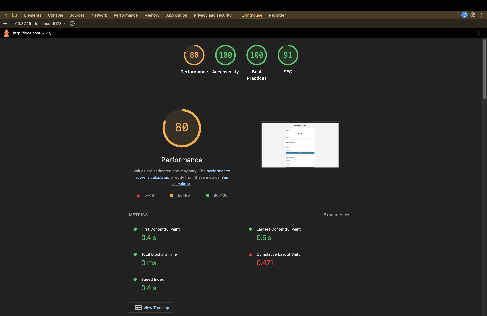

# Budget Tracker

En enkel budgetapp för att hålla koll på inkomster och utgifter.

## Funktioner

- Lägg till inkomster och utgifter med beskrivning, belopp och kategori
- Se total balans, inkomster och utgifter
- Balansen visas i grönt (positivt) eller rött (negativt)
- Ta bort transaktioner
- Kategorier laddas från en JSON-fil
- Data sparas i localStorage

## Tekniker

- Vite
- TypeScript
- HTML & CSS
- ESLint
- Prettier

## Lighthouse

| Kategori       | Poäng |
| -------------- | ----- |
| Performance    | 80    |
| Accessibility  | 100   |
| Best Practices | 100   |
| SEO            | 91    |

## Live demo

[Budget Tracker](https://medieinstitutet.github.io/fed25d-js-inl-2-budget-app-oscarholmblad/)
